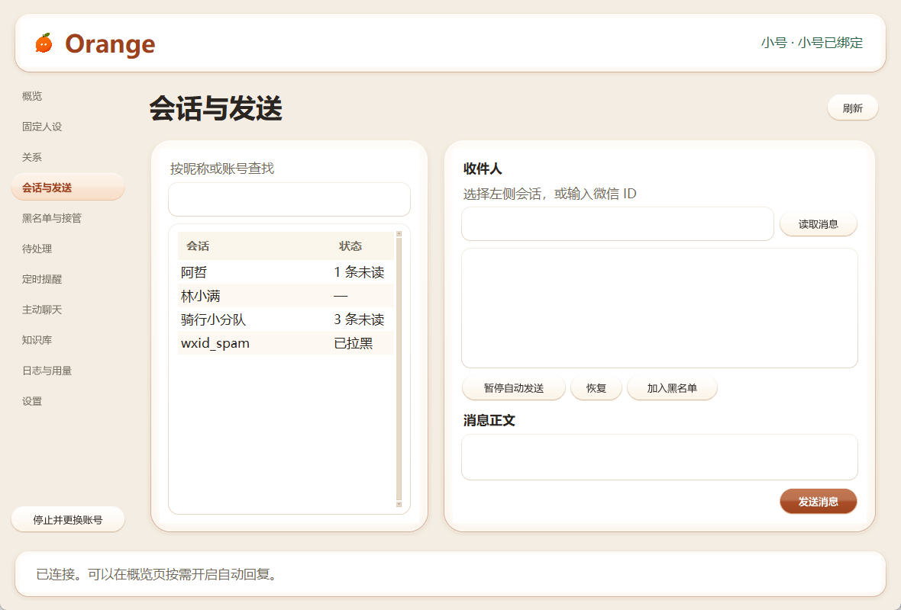
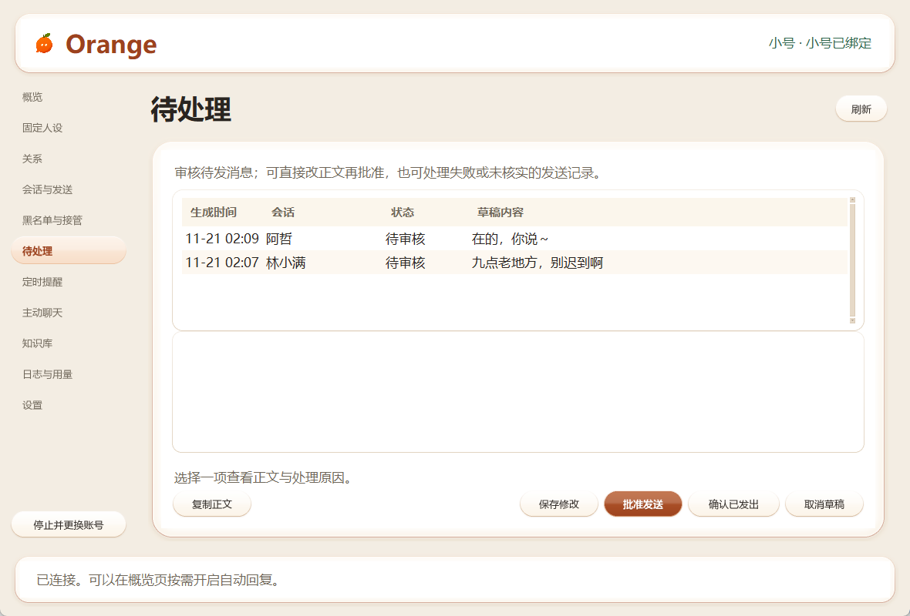
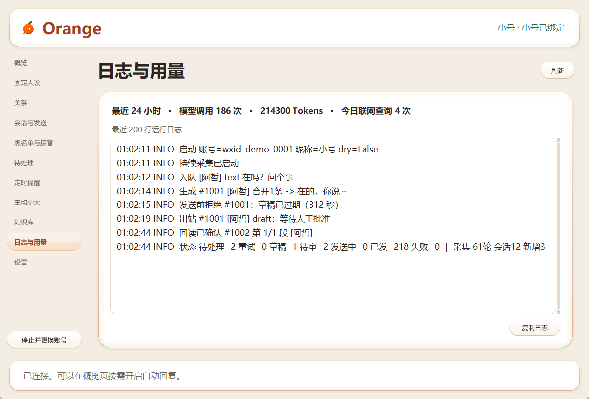

# Orange · 把微信小号变成「会记人」的 AI 秘书

不是群发工具，也不是"有求必应"的客服机器人。
它接管你**一个微信小号**：看懂对方在说什么、按人设回得像个人、记得每个人的关系和旧事，
还能自己找话题、到点提醒、遇到敏感承诺先交给你审。


> 本文截图都是**演示数据**（`wxid_demo` / 阿哲 / 林小满），由真实界面 + 假后台渲染，
> 不含任何真实账号或聊天内容。

---

## 这是什么

| 场景 | 它怎么做 |
| --- | --- |
| 对方发来一句「在吗」 | 先读懂（含同音错字/半句话），按这个人的关系和人设生成回复，拆成 1–2 个气泡发出去 |
| 一天来 50 个人 | 每人一条记忆线：原文窗口、滚动摘要、画像、事实，越聊越像认识 |
| 说「明天八点叫我」 | 自动抽成定时提醒，到点自己发；迟到会标"晚了点"，太晚就作废 |
| 很久没说话 | 在活跃时段自己找个话题开口；每天上限、间隔、静默期都能按人单独调 |
| 借钱 / 约时间 / 打包票 | 不自动发，进「待处理」等你改一句再点批准 |
| 群里被 @ | 只接被点名的；会判断"谁对谁说话"，@ 回去时认得人 |

**默认全部开关都是关的**：装完不会自己发任何消息，要在面板里逐个打开。

---

## 界面

### 1. 连接小号

选本机已登录的小号 → 勾选确认 → 选模型 API → 「连接并启动」。
后台服务（采集/发送）由 GUI 自动拉起，不需要另开窗口。


### 2. 概览：一眼看住状态

未处理、重试、排队、待审、已发、失败、待核验、暂停，八个数字 + 最近收到的消息。


### 3. 会话与发送：手动干预

按昵称/wxid 搜索会话；可以直接给某人发一句话，或者把某个会话「暂停自动发送」。



### 4. 待处理：人工审核

敏感承诺、被截断的回复、`draft_only` 联系人都停在这里。可以改正文、批准、标记已发或作废。



### 5. 主动聊天：自己找话题

只对白名单里的私聊开口；每人有独立配额、间隔、静默期，"下次尝试"时间一目了然。


### 6. 日志与用量

最近 200 行运行日志 + 24 小时模型调用/Token/联网次数。日志里聊天正文默认脱敏（只留长度和指纹）。



---

## 工程亮点

### 1. 四段式流水线，每一段都能单独观察

```
微信 PC 客户端（只读本机解密库，不挂 Hook、不发协议包）
        │
        ▼
   采集线程 ──► SQLite 队列（inbound / outbound / 水位 / 钩子 / 暂停）
        │                     │
        │                     ├─► 门禁：开关 · 黑白名单 · 时段 · 接管 · 过期 · 配额
        │                     ▼
        │                  生成：记忆 + 人设卡 + 关系表 + 知识库 + 联网 → 拆气泡
        │                     ▼
        │                  发送：找会话窗 → 双击开独立窗 → 写内容 + 回车 → 回读核验
        ▼
   对账线程：未核实 / 不确定 / 进程中断后的恢复
```

采集、生成、发送、对账是四个独立线程，互不阻塞；模型慢或微信卡住不会把采集憋死。

### 2. 队列是状态机，不是内存列表

- 入站有 `pending / retry / done / skipped / expired`，出站有 `draft / hold / sending / sent / failed / uncertain`；
- 每次提交都带「回读水位」：发出去后回读微信库，确认真的出现了才算成功；
- 进程崩了重启会自动恢复：`sending` 退回 `uncertain`（先核验，不重发），残留锁自动清理。

### 3. 发送侧三重校验（宁可没发，也不发错人）

1. 聊天窗的 `AutomationId` 必须等于 `ChatSingleWindow + 目标 wxid`；
2. 写入后回读输入框内容，必须与待发文本逐字一致；
3. 回车前后各校验一次窗口身份，任何变化立即中止。

### 4. 「不打扰」的后台发送

- 双击消息直接 `PostMessage` 给微信，不动鼠标、不抢焦点；
- 独立聊天窗开出来立刻挪到屏幕外；
- 主窗最小化 / 关到托盘 / 停在通讯录页都能自愈（详见「已知限制」里的托盘机制）。

### 5. 记忆与去重契约

- 记忆分四层：原文窗口 → 摘要 + 画像 + 事实 → 事实去重 → 习惯观察；完整原文始终留在 SQLite；
- 入站去重只有**一处**契约：`UNIQUE(账号, 会话, local_id, msg_ts)`。不去碰微信那个会重编号的 `local_id` 身份；
- 状态行带采集健康度（`采集 N轮 会话M 新增K`），长期为 0 说明采集器没在扫。

### 6. 换机器、出问题，都有现成工具

| 工具 | 用途 |
| --- | --- |
| `导出数据.bat` / `导入数据.bat` | 数据打包 / 恢复；没放数据包时自动按「就地适配」修正整目录拷贝 |
| `python tools\why_no_reply.py` | 消息收到了却不回复：一次看清进程、Key、开关、日志、队列 |
| `python tools\replay_chat.py` | 消息被误判丢弃后，回退采集水位重放 |
| `python tools\proactive_status.py` | 主动聊天体检：每个联系人"会不会发 / 为什么还等" |
| `python tools\tray_selfcheck.py` | 换电脑后确认托盘图标能否自动点开 |
| `诊断.bat` | 环境自检：Python / 微信 / 端口 / 进程 / 最近日志 |

### 7. 32 个测试文件，全离线

`python run_tests.py` 每个用例独立进程 + 临时数据库，不碰真实微信和真实数据；
覆盖队列状态机、门禁、合并窗口、记忆幂等、发送核验、迁移、GUI 页面构建等。

---

## 快速开始

> 需要 Windows 10/11 + **微信 PC 客户端 4.1.12+**（本项目在 4.2.0.13 上完整验证）。

```bat
:: 1. 装环境：自动补 Python 3.12（64 位）、装依赖、生成 config.json / persona_card.json
安装.bat

:: 2. 在电脑上登录你的【小号】，保持微信运行

:: 3. 启动界面
GUI\启动 Orange.bat

:: 4.（可选）桌面/开始菜单快捷方式，按当前文件夹路径现算
创建快捷方式.bat
```

界面里四步：

1. 选中你要授权的小号 → 勾选「我确认选中的账号是小号」；
2. 「模型 API」选一个来源，第一次要填 Key（DeepSeek / Kimi / 通义 / 本地 Ollama 都行）；
3. 点「连接并启动」等它就绪；
4. **到「概览」把「自动回复」打开**，要用主动聊天/提醒再去对应页面开。

> 之后每次「连接并启动」，这些开关都会回到关闭状态（安全设计），需要重新点开。

---

## 目录

| 路径 | 作用 |
| --- | --- |
| `GUI/` | 图形界面（日常只用 `GUI\启动 Orange.bat`） |
| `agent/reply_worker.py` | 采集 / 生成 / 发送 / 对账 四段式主进程 |
| `agent/brain.py` | 拼上下文、调模型、识图、敏感话术判断（不写记忆、不发送） |
| `agent/wxqueue.py` | 持久化队列、状态机、暂停、机器人发言登记 |
| `agent/gate.py` | 发送门禁（开关 / 名单 / 时段 / 过期 / 接管 / 配额） |
| `agent/persona.py` `persona_card.py` | 人设卡与系统提示词 |
| `agent/proactive.py` `reminder.py` | 主动聊天调度、定时提醒 |
| `agent/kb.py` | 知识库：导入、切块、检索 |
| `memory/store.py` | 每个联系人一条记忆线 |
| `wxbot/wx_service.py` | 本地 HTTP 服务（发送、查询、待审、配置、日志） |
| `wxbot/wx_engine.py` | 窗口定位与后台发送 |
| `tools/` | 迁移、备份、诊断、重放脚本 |
| `tests/` | 离线测试（全部使用临时库） |

---

## 配置要点

完整示例见 `config.example.json`；实际配置是 `config.json`（已 gitignore，首次安装时生成）。

- **API Key** 不写进仓库：存在 `%USERPROFILE%\.orange\api_keys.json`，GUI 里可选用/删除。
- **黑白名单**：默认谁都会回。要排除某人或某个群，加进 `agent.reply_blacklist`
  （支持 `wxid_xxx` 和 `数字@chatroom`，人和群同一份名单）；拉黑后群里 @ 也不回。
- **群聊**：`agent.group_reply=true` 才启用，默认 `at_only`（被 @ 才接话）；
  被 @ 后 5 分钟内同一人接着说也会回。
- **连发合并**：对方连发几句并成一轮只回一次；静默窗口按"完整句 / 普通 / 半句 / 表情"分档。
- **拆气泡**：默认一条回复一个气泡，只有模型主动换行才拆成最多 2 条。
- **记忆**：`memory.max_turns` / `summary_threshold` / `max_context_chars` 控制上下文预算。
- **待审**：敏感承诺、被截断的回复、`draft_only` 联系人一律不自动发。
- **联网**：默认关闭；打开后每轮最多 2 次查询 / 3 个页面 / 8 秒。
- **隐私**：`logging.chat_content=false` 时日志里不写聊天正文。

---

## 常见问题

**Q：界面显示收到消息，但它不回？**
先看「概览」的「自动回复」是否打开；仍然不动就跑 `python tools\why_no_reply.py`，
它会直接告诉你卡在进程、Key、开关还是队列。

**Q：微信关到托盘 / 最小化 / 停在通讯录页还能发吗？**
能。程序会热激活控件树、点微信自己的托盘图标把窗口叫出来、或切回聊天页，
用完把主窗放回原处藏起来。第一次约多花 2–5 秒。

**Q：换电脑怎么搬数据？**
旧电脑 `导出数据.bat` → 新电脑 `导入数据.bat`（没放数据包时会按「就地适配」修正）。
详见 `迁移说明.md`。

**Q：发不出去，日志里写着 `main_in_tray` / `session_list_unavailable`？**
`main_in_tray` = 托盘图标点不出来（锁屏、微信被设成关闭即退出、任务栏被替换）；
`session_list_unavailable` = 读不到会话列表（不在聊天页、窗口异常）。都是可重试的，等下一次即可。

**Q：电脑锁屏后还会回吗？**
不会：点击托盘图标是真实鼠标动作，锁屏下无效。重试几次后会记为失败，解锁后可在「待处理」里批准重发。

**Q：用这个会被封号吗？**
自动化操作微信不符合微信用户协议，**有被封号的可能，风险自负**。只用自己的小号，别拿主号试。

---

## 开发

```bat
python run_tests.py            :: 全部（每个用例独立进程 + 临时库）
python run_tests.py queue      :: 只跑文件名含 queue 的
python agent\brain.py wxid_xxx "在吗"   :: 只生成草稿，不发送
python agent\tune.py "在吗"             :: 调语气看效果
python tools\backup_db.py               :: 备份数据库 + 配置
```

架构改动请先看 `agent/wxqueue.py`（队列契约）、`agent/gate.py`（门禁）、
`wxbot/wx_engine.py`（发送核验）这三处，它们是整套行为的边界。

---

## 已知限制

- **发送靠 UI 自动化**：微信大版本更新后控件可能变，需要重新校准 `wxbot` 里的控件定位。
- **同一时间只能跑一个会话**：文件锁互斥，重复启动会被拒绝。
- **开新会话窗口会抢一次前台**：已开过的会话窗口会被挪到屏幕外；遇到全屏游戏时任务保留、45 秒后重试。
- **知识库只导入白名单目录**：只接受「桌面/文档/下载」和投喂目录，其他目录写进 `kb.ingest_roots`。
- **表情包发送未接通**：`stickers.enabled` 开关暂不生效。
- **语音**需要额外装 `pilk` 并打开 `media.voice_asr`，否则只记「对方发来一条语音」。
- **锁屏 / 无人值守会话**下无法点击微信窗口，发送会失败（可重试/人工批准）。
- **多账号同时登录**时托盘可能点到别的微信号，表现为本实例窗口不出现（失败可重试，不会发错人）。

---

## 免责声明

本项目与腾讯、微信官方无关，仅用于个人学习与技术研究。
使用自动化手段操作微信**不符合微信用户协议**，可能导致账号受限，**风险自负**。
请勿用于群发广告、骚扰他人或任何违法用途。

## License

[MIT](LICENSE)
