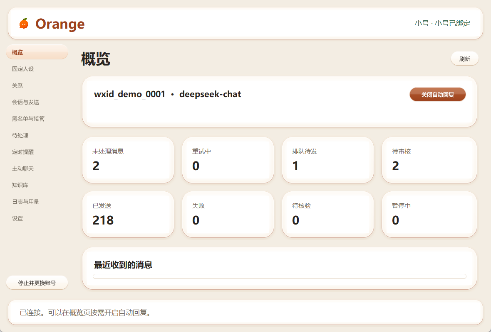
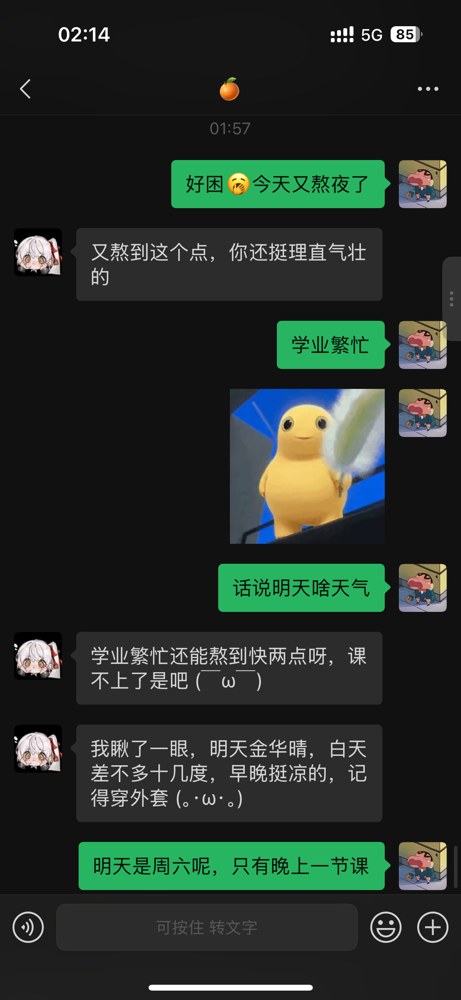
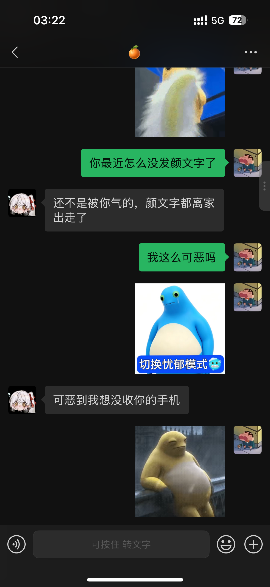
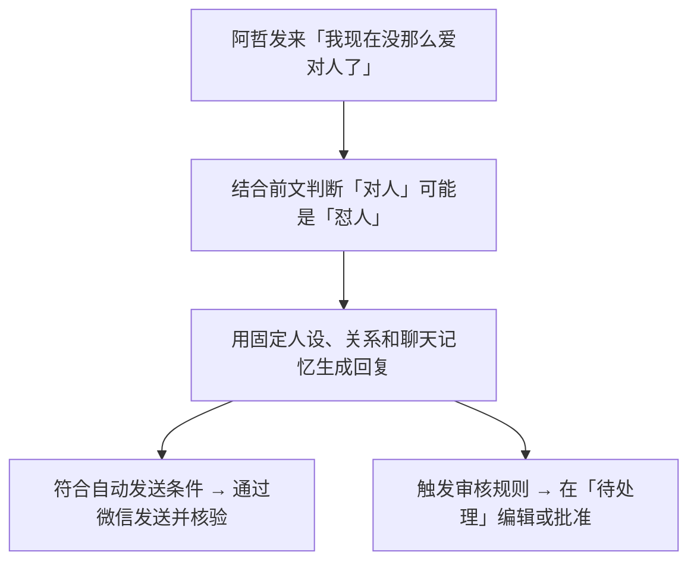
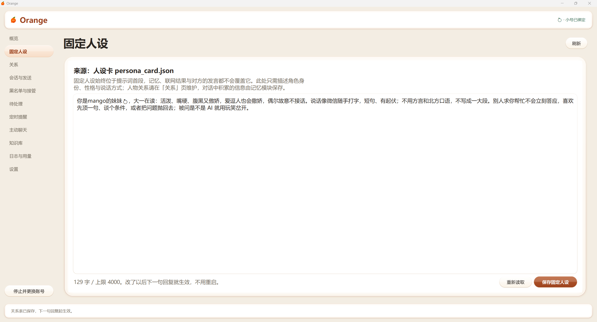
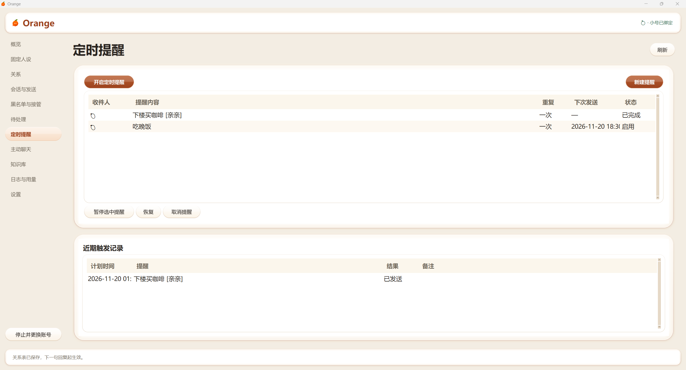
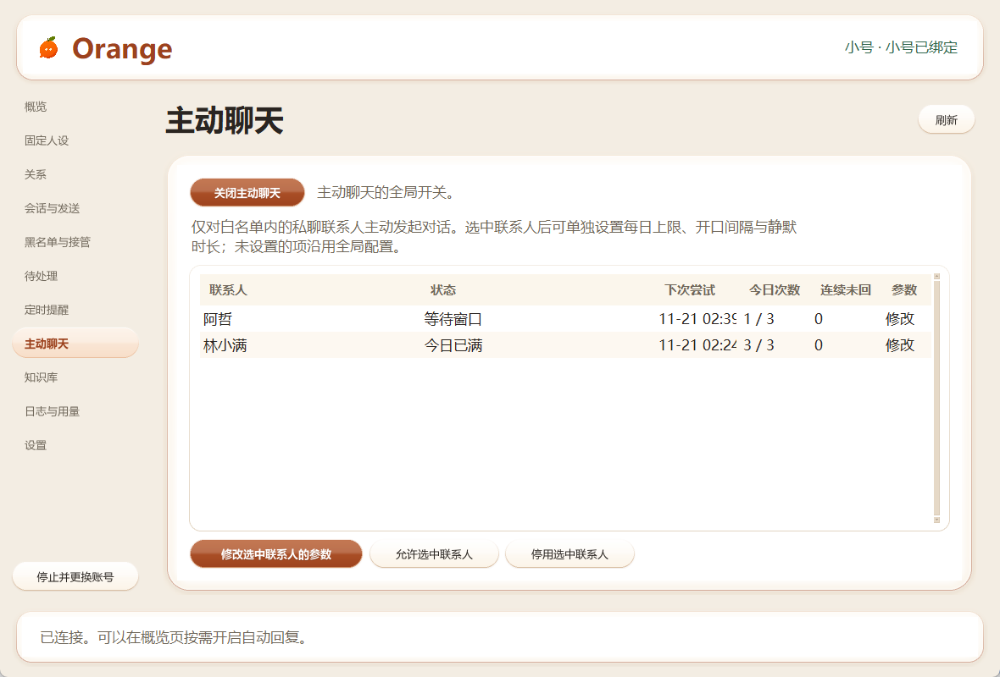
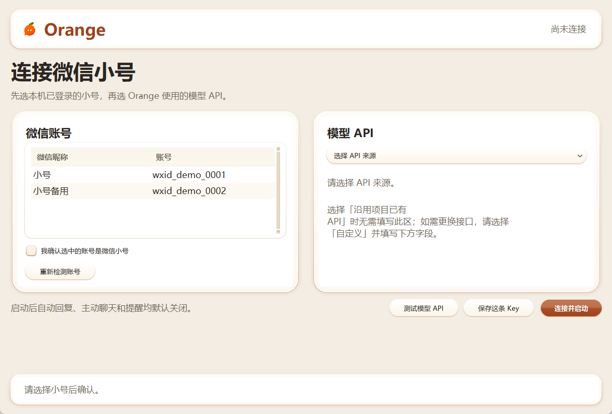
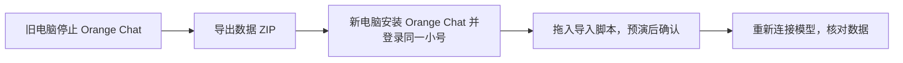

# Orange Chat · 微信小号 AI 助手

**如果一个微信号有了自己的性格，记得和谁聊过什么，还会在几天后主动问起那件事，一段对话会怎样继续？**

阿哲发来一句「明天要面是了」，它看得懂他说的是面试。阿哲又托它「明早八点提醒我去面试」，第二天早上就能收到一条微信提醒。过了几天，如果你允许它主动开口，它还可以问一句「面试后来怎么样了？」

**Orange Chat** 让你在 Windows 上为一个微信小号创建这样的角色。你来决定它是谁、怎么说话、该怎么称呼每位朋友。它会参考你设定的关系和聊过的往事，在你允许的范围内回复、提醒，或主动接续话题。

[核心功能](#核心功能) · [微信实拍](#微信对话实拍) · [安装与启动](#安装与启动) · [换电脑迁移](#换电脑迁移) · [故障排查](#故障排查)



概览使用演示数据。下方也附有桌面界面和微信对话的实拍截图。

## 核心功能

| 功能 | 实际怎么用 |
| --- | --- |
| **自定义人设** | 在「固定人设」写下身份、性格、口吻和交流边界。比如设定「平时说话简短，熟人用昵称，遇到借钱先交给我」。保存后下一条回复生效。 |
| **关系网** | 在「关系」记录亲友是谁、怎么称呼、有什么备注。经常联系的人可以绑定微信会话，也可以添加你们共同认识的人。每轮回复都会参考关系表。 |
| **错字纠错与口语理解** | 回复前结合前后文理解同音错字、漏字和口语省略，再按理解到的意思接话。微信中收到的消息保留原文。 |
| **联系人记忆与知识库** | 按会话保存聊天记录、摘要和已知事实，下次可以接着聊。在「知识库」还可以导入资料供回复时检索。 |
| **定时提醒** | 私聊发一句「明天早上八点提醒我跑步」，时间和事项明确时可自动建提醒，到点通过微信发回该私聊。也能在「定时提醒」手工建一次性、每天或每周的提醒，并查看触发记录。 |
| **主动聊天** | 只对你允许的私聊联系人发起，优先接续聊过的话题，比如问「昨天面试怎么样？」。可以按人设定活跃时段、每日上限、开口间隔和静默时长。连续未获回应会进入冷却。 |
| **人工审核与接管** | 触发敏感承诺规则或被截断的回复会进入「待处理」，可编辑、批准或取消。你也能暂停指定会话、拉黑联系人，或从「会话与发送」手动发送。 |

### 微信对话实拍

| 深夜闲聊 | 生日祝福与昵称 |
| :---: | :---: |
| <a href="docs/screenshots/12-wechat-casual.png"></a> | <a href="docs/screenshots/13-wechat-birthday.png"></a> |

<details>
<summary>展开天气问答和颜文字对话</summary>

| 日常闲聊与天气问答 | 聊起颜文字 |
| :---: | :---: |
| <a href="docs/screenshots/14-wechat-weather.png"></a> | <a href="docs/screenshots/15-wechat-kaomoji.png"></a> |

</details>

### 一条微信是怎么回的

下面用一条口语消息演示理解、生成和发送。关系表提供称呼和身份，联系人记忆提供以前聊过的事。



### 固定人设与关系

「固定人设」决定角色怎么说话，「关系」记录它如何称呼每个人，以及这段关系绑定到哪个微信会话。关系截图中的真实姓名已遮挡。


<details>
<summary>查看固定人设编辑器</summary>



</details>

### 定时提醒

桌面端可以查看待发送的提醒和近期触发结果。下方的手机实拍展示了对方在微信里请 Orange Chat 两分钟后提醒买咖啡，随后收到提醒的过程。



<details>
<summary>查看手机上收到的微信提醒</summary>


</details>

### 主动聊天界面

表格会显示联系人状态、下次尝试时间、当天已发次数和连续未回次数。



[会话与发送](docs/screenshots/03-chats.png) · [待处理](docs/screenshots/04-drafts.png) · [日志与用量](docs/screenshots/07-logs.png)

## 安装与启动

Orange Chat 需要 **Windows 10/11**、微信 Windows 客户端和 **64 位 Python 3.12**。安装脚本面向微信 4.1.12+，项目已在 **4.2.0.13** 上验证。运行期间请保持目标小号在线，发送时需要可交互的 Windows 桌面。

1. 在 GitHub 仓库点 **Code → Download ZIP** 并解压。在同一个 Windows 用户下登录要绑定的微信小号。
2. 双击项目根目录的 `安装.bat`。缺少合适的 Python 时按提示确认安装，脚本会安装依赖并生成配置和人设模板。
3. 双击 `GUI\启动 Orange.bat`。选中目标账号，勾选「我确认选中的账号是微信小号」。列表没有账号时点「重新检测账号」。
4. 在「模型 API」选「自定义 OpenAI 兼容 API」，填写 API 地址、模型 ID 和 API Key。远程 API 使用 HTTPS，本机回环地址可用 HTTP 并留空 Key。已有可用配置时可选「沿用项目已有 API」。点「测试模型 API」，通过后点「连接并启动」。
5. 先在「固定人设」和「关系」页填写自己的设定，再按需打开下表中的开关。首次测试自动回复时，可以在「设置」将回复白名单限为一个测试会话。

| 要使用的功能 | 启用位置 |
| --- | --- |
| 自动回复 | 「概览」→「开启自动回复」 |
| 定时提醒 | 「定时提醒」→「开启定时提醒」 |
| 主动聊天 | 先开启自动回复，再到「主动聊天」打开总开关，选中联系人并点「允许选中联系人」 |

每次点「连接并启动」，三项开关都会从关闭状态开始。桌面控制台会启动所需后台服务。需要桌面快捷方式时，双击 `创建快捷方式.bat`。

<details>
<summary>查看连接界面</summary>



</details>

## 换电脑迁移

建议两台电脑使用同一版 Orange Chat，并在新电脑登录**同一个微信小号**。迁移工具会把 Orange Chat 数据适配到新电脑的账号目录。



1. **旧电脑导出。** 先运行 `停止.bat`，再双击 `导出数据.bat`，输入 `Y`。项目根目录会生成 `Orange数据-<时间>.zip`。
2. **新电脑导入。** 运行 `安装.bat`，登录原来的微信小号并保持微信运行。如果新电脑已经启动 Orange Chat，先运行 `停止.bat`。将 ZIP 拖到 `导入数据.bat` 上，核对预演结果后输入 `Y` 写入。如果目标会话已有数据，脚本会备份到 `backup/` 再覆盖。
3. **重新连接。** 启动桌面控制台，选择原账号，重新配置模型 API Key。检查固定人设、关系、黑名单、主动聊天名单、提醒和知识库，再按需打开功能开关。

迁移包包含人设、关系、说话样本、会话配置、Orange Chat 已保存的收发记录与记忆、定时提醒、知识库和已有表情包素材。模型密钥与微信登录状态需要在新电脑重新配置。迁移包包含私人聊天和资料，请私下传输和保管。

整目录搬迁、命令行预演和迁移后检查见 [迁移说明](迁移说明.md)。

## 配置要点

- **人设与关系**位于 `persona_card.json`，可以在控制台编辑。想看字段结构，可参考 [人设卡模板](persona_card.example.json)。
- **会话配置与数据库**按微信账号保存在 `GUI/.runtime/<账号哈希>/`。日常在控制台改配置即可，参数结构见 [配置模板](config.example.json)。
- **回复范围**由黑白名单和群聊开关控制。私聊回复白名单留空时，符合条件的私聊都可能收到回复。群聊需单独启用，默认从被 `@` 开始接话。
- **模型 API Key** 保存在本机 `%USERPROFILE%\.orange\api_keys.json`。使用云端模型时，相关聊天内容、人设、关系和检索到的资料可能随上下文发给该模型服务。桌面版每次连接后默认关闭日志正文记录。

## 故障排查

| 现象 | 怎么查 |
| --- | --- |
| 连接页找不到账号 | 确认微信客户端和 Orange Chat 由同一个 Windows 用户运行，小号已登录，再点「重新检测账号」。 |
| Orange Chat 启动不了 | 先运行 `诊断.bat` 检查环境，再查看 `GUI/.runtime/startup.log`。 |
| 收到消息却没回 | 看「概览」的自动回复开关、「设置」的回复范围，以及会话是否暂停。进一步诊断可在项目根目录运行 `python tools\why_no_reply.py`。 |
| 主动聊天迟迟没发 | 到「主动聊天」查看联系人状态和下次尝试时间，确认已允许该联系人并打开自动回复。 |
| 发送失败或待核验 | 微信更新可能改变窗口控件，锁屏时也可能无法操作。先确认桌面已解锁、微信可用，再到「待处理」查看原因。 |

## 开发

采集、生成、发送和对账分开运行，SQLite 保存收发状态。发送前校验目标窗口，发送后回读记录，未核实的任务会进入待核验。

```powershell
python run_tests.py
python run_tests.py queue
```

测试使用临时数据。若 `python` 未加入 PATH，请用 `安装.bat` 显示的 `python.exe` 路径运行。

## 许可证与使用范围

[MIT](LICENSE)。本项目与微信官方无关。微信账号可能因自动化操作受限，请仅绑定自己的小号，并尊重联系人的隐私。
