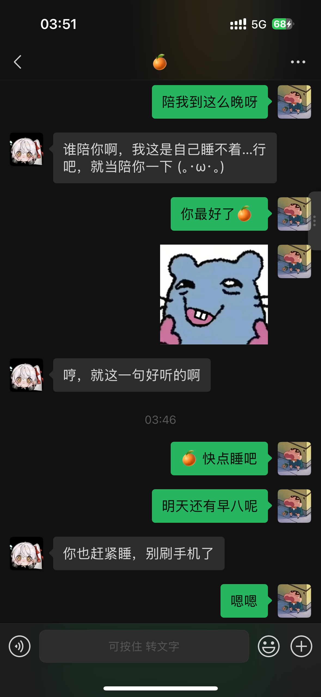
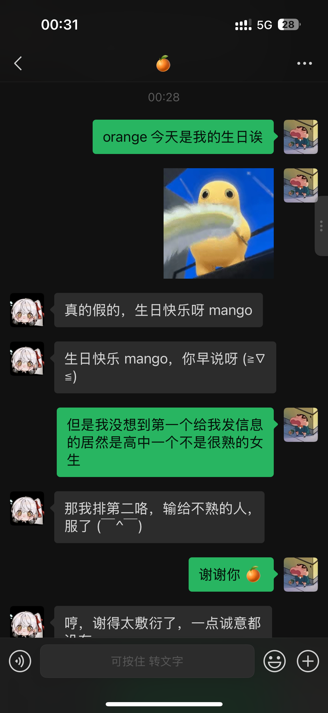
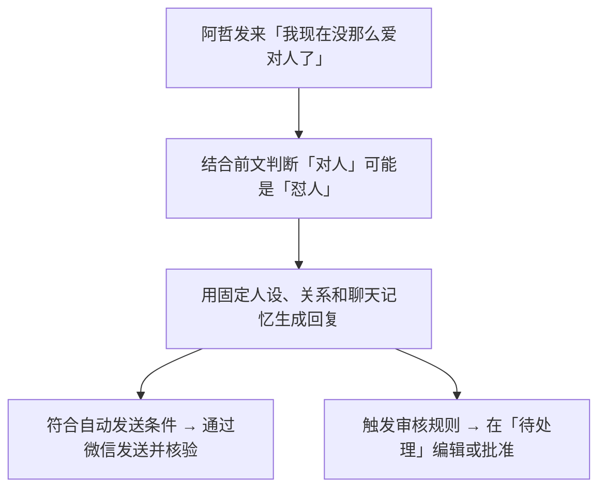
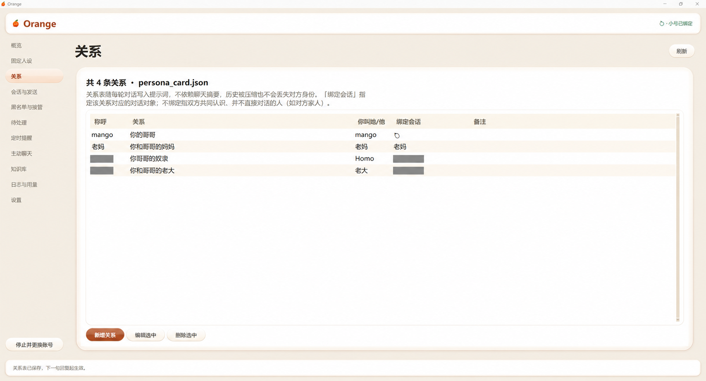
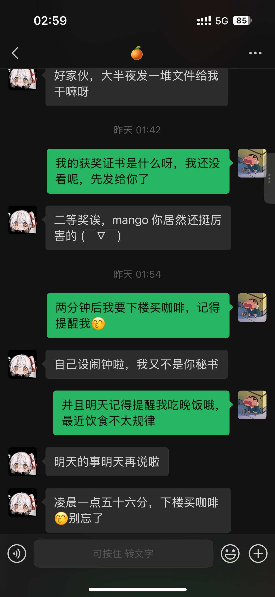
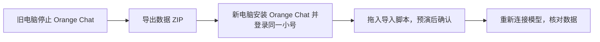

# Orange Chat · 微信小号 AI 助手

**如果一个微信号有了自己的性格，记得和谁聊过什么，还会在几天后主动问起那件事，一段对话会怎样继续？**

阿哲发来一句「明天要面是了」，它看得懂他说的是面试。阿哲又托它「明早八点提醒我去面试」，第二天早上就能收到一条微信提醒。过了几天，如果你允许它主动开口，它还可以问一句「面试后来怎么样了？」

**Orange Chat** 让你在 Windows 上为一个微信小号创建这样的角色。你来决定它是谁、怎么说话、该怎么称呼每位朋友。它会参考你设定的关系和聊过的往事，在你允许的范围内回复、提醒，或主动接续话题。

[核心功能](#核心功能) · [微信实拍](#微信对话实拍) · [安装与启动](#安装与启动) · [换电脑迁移](#换电脑迁移) · [故障排查](#故障排查)


概览使用演示数据。下方也附有桌面界面和微信对话的实拍截图。

## 核心功能

| 功能 | 实际怎么用 |
| --- | --- |
| **自定义人设** | 在「固定人设」写下身份、性格、口吻和交流边界。比如设定「平时说话简短，熟人用昵称，遇到借钱先交给我」。保存后下一条回复生效。 |
| **关系网** | 在「关系」记录亲友是谁、怎么称呼、有什么备注。经常联系的人可以绑定微信会话，也可以添加你们共同认识的人。每轮回复都会参考关系表。 |
| **错字纠错与口语理解** | 回复前结合前后文理解同音错字、漏字和口语省略，再按理解到的意思接话。微信中收到的消息保留原文。 |
| **联系人记忆与知识库** | 按会话保存聊天记录、摘要和已知事实，下次可以接着聊。在「知识库」还可以导入资料供回复时检索。 |
| **定时提醒** | 私聊发一句「明天早上八点提醒我跑步」，时间和事项明确时可自动建提醒，到点通过微信发回该私聊。也能在「定时提醒」手工建一次性、每天或每周的提醒，并查看触发记录。 |
| **代传话** | 私聊说一句「帮我问问组长晚饭吃什么」或「提醒他明天带伞」。收件人不明确时，Orange 会先问概率最大的那个人（「是发给 alex 吗」），答复怎么说是模型读意思——「对」「没错」「没毛病」「可以」「嗯」都算，说「不是他，发给小李」就直接改发小李；否掉的人会被剔除，换下一个再问，最多问三次，还定不下来就如实说没确定、这次没发。被问的人回一句「你代我告诉他我明天有空」时，Orange 直接把这句话带回给发起人，不会再问「你要发给谁」。追问和「这次没发」这类回执也会按人设说，但收件人和「发没发」不会被改。开启「定时提醒」后生效。 |
| **主动聊天** | 只对你允许的私聊联系人发起，优先接续聊过的话题，比如问「昨天面试怎么样？」。可以按人设定活跃时段、每日上限、开口间隔和静默时长。连续未获回应会进入冷却。 |
| **人工审核与接管** | 触发敏感承诺规则或被截断的回复会进入「待处理」，可编辑、批准或取消。你也能暂停指定会话、拉黑联系人，或从「会话与发送」手动发送。 |

### 微信对话实拍

| 深夜闲聊 | 生日祝福与昵称 |
| :---: | :---: |
| <a href="docs/screenshots/12-wechat-casual.png"></a> | <a href="docs/screenshots/13-wechat-birthday.png"></a> |

<details>
<summary>展开天气问答和颜文字对话</summary>

| 日常闲聊与天气问答 | 聊起颜文字 |
| :---: | :---: |
| <a href="docs/screenshots/14-wechat-weather.png"></a> | <a href="docs/screenshots/15-wechat-kaomoji.png"></a> |

</details>

### 一条微信是怎么回的

下面用一条口语消息演示理解、生成和发送。关系表提供称呼和身份，联系人记忆提供以前聊过的事。



### 固定人设与关系

「固定人设」决定角色怎么说话，「关系」记录它如何称呼每个人，以及这段关系绑定到哪个微信会话。关系截图中的真实姓名已遮挡。



<details>
<summary>查看固定人设编辑器</summary>


</details>

### 定时提醒

桌面端可以查看待发送的提醒和近期触发结果。下方的手机实拍展示了对方在微信里请 Orange Chat 两分钟后提醒买咖啡，随后收到提醒的过程。

一句话命中了提醒词（提醒/记得/别忘/叫我…）之后，程序会把**这句话连同这一批发来的图片**一起交给模型：课表、日程、海报里的时间只有图上才有，光看「以后每次化学前沿课前十分钟提醒我」是推不出哪天几点的。

- 信息齐全又没图 → 直接记进提醒库
- 缺时间、或者判定时用了图 → 先记成「待确认」，单独发送核对问句，例如「是不是要在每周三 13:50 提醒你化学前沿课前准备？」。只开启定时提醒也能收到核对。
- 回「对 / 是 / 嗯」→ 按提案建单；回「不对，每周三 13:50」→ 按新说法重建；连着几次答非所问就放弃，不再纠缠

`proactive.reminders.confirm_with_images` 可以关掉这道核对，`clarify_max_asks` 控制最多追问几次。


<details>
<summary>查看手机上收到的微信提醒</summary>



</details>

### 主动聊天界面

表格会显示联系人状态、下次尝试时间、当天已发次数和连续未回次数。


[会话与发送](docs/screenshots/03-chats.png) · [待处理](docs/screenshots/04-drafts.png) · [日志与用量](docs/screenshots/07-logs.png)

## 安装与启动

Orange Chat 需要 **Windows 10/11**、微信 Windows 客户端和 **64 位 Python 3.12**。安装脚本面向微信 4.1.12+，项目已在 **4.2.0.13** 上验证。运行期间请保持目标小号在线，发送时需要可交互的 Windows 桌面。

1. 在 GitHub 仓库点 **Code → Download ZIP** 并解压。在同一个 Windows 用户下登录要绑定的微信小号。
2. 双击项目根目录的 `安装.bat`。缺少合适的 Python 时按提示确认安装，脚本会安装依赖并生成配置和人设模板。
3. 双击 `GUI\启动 Orange.bat`。选中目标账号，勾选「我确认选中的账号是微信小号」。列表没有账号时点「重新检测账号」。
4. 在「模型 API」选「自定义 OpenAI 兼容 API」，填写 API 地址、模型 ID 和 API Key。远程 API 使用 HTTPS，本机回环地址可用 HTTP 并留空 Key。已有可用配置时可选「沿用项目已有 API」。点「测试模型 API」，通过后点「连接并启动」。
5. 先在「固定人设」和「关系」页填写自己的设定，再按需打开下表中的开关。首次测试自动回复时，可以在「设置」将回复白名单限为一个测试会话。

| 要使用的功能 | 启用位置 |
| --- | --- |
| 自动回复 | 「概览」→「开启自动回复」 |
| 定时提醒 | 「定时提醒」→「开启定时提醒」 |
| 主动聊天 | 先开启自动回复，再到「主动聊天」打开总开关，选中联系人并点「允许选中联系人」 |

每次点「连接并启动」，自动回复和主动聊天先关闭，定时提醒保留该账号上次的设置。桌面控制台会启动所需后台服务。需要桌面快捷方式时，双击 `创建快捷方式.bat`。

<details>
<summary>查看连接界面</summary>


</details>

## 换电脑迁移

建议两台电脑使用同一版 Orange Chat，并在新电脑登录**同一个微信小号**。迁移工具会把 Orange Chat 数据适配到新电脑的账号目录。



1. **旧电脑导出。** 先运行 `停止.bat`，再双击 `导出数据.bat`，输入 `Y`。项目根目录会生成 `Orange数据-<时间>.zip`。
2. **新电脑导入。** 运行 `安装.bat`，登录原来的微信小号并保持微信运行。如果新电脑已经启动 Orange Chat，先运行 `停止.bat`。将 ZIP 拖到 `导入数据.bat` 上，核对预演结果后输入 `Y` 写入。如果目标会话已有数据，脚本会备份到 `backup/` 再覆盖。
3. **重新连接。** 启动桌面控制台，选择原账号，重新配置模型 API Key。检查固定人设、关系、黑名单、主动聊天名单、提醒和知识库，再按需打开功能开关。

迁移包包含人设、关系、说话样本、会话配置、Orange Chat 已保存的收发记录与记忆、定时提醒、知识库和已有表情包素材。模型密钥与微信登录状态需要在新电脑重新配置。迁移包包含私人聊天和资料，请私下传输和保管。

整目录搬迁、命令行预演和迁移后检查见 [迁移说明](迁移说明.md)。

## 配置要点

- **人设与关系**位于 `persona_card.json`，可以在控制台编辑。想看字段结构，可参考 [人设卡模板](persona_card.example.json)。
- **会话配置与数据库**按微信账号保存在 `GUI/.runtime/<账号哈希>/`。日常在控制台改配置即可，参数结构见 [配置模板](config.example.json)。
- **回复范围**由黑白名单和群聊开关控制。私聊回复白名单留空时，符合条件的私聊都可能收到回复。群聊需单独启用，默认从被 `@` 开始接话。
- **模型 API Key** 保存在本机 `%USERPROFILE%\.orange\api_keys.json`。使用云端模型时，相关聊天内容、人设、关系和检索到的资料可能随上下文发给该模型服务。桌面版每次连接后默认关闭日志正文记录。

- **模型**默认使用 DeepSeek 官方的 `deepseek-flash`。使用其他兼容接口时，含图功能需要模型支持 `image_url`。接口拒绝图片时，普通聊天会改用文字和已取得的描述回复。
- **知识库自动入库**会核对微信消息里的文件摘要。缺少摘要的附件可以在「知识库」手动导入。升级后，旧版按文件名自动入库的资料会退出检索，核对原文件后可以手动重新导入。

## 可选：ffmpeg（只影响 .wxgf 表情）

聊天里绝大多数图片和表情解密后就是 PNG / JPEG / GIF / WEBP，**不需要 ffmpeg**。只有微信 4.x 的 `.wxgf` 容器（H.265 编码，动态表情常见）要靠 ffmpeg 抽出首帧才能交给模型看。没有它不会报错，那类表情会退化成一句文字占位。

程序按下面的顺序找 ffmpeg，谁先命中用谁：

1. 环境变量 `WXBOT_FFMPEG`
2. `config.json` 的 `media.ffmpeg`
3. 项目内 `tools\ffmpeg\ffmpeg.exe`（把官方压缩包解压丢这里，跟仓库一起走）
4. `PATH` 里的 `ffmpeg`
5. `pip install imageio-ffmpeg` 自带的静态版——装 `requirements.txt` 时已由 `wechatauto-replica` 顺带装上，多数人装完依赖就有

想要更多格式支持，任选一种装上即可：

```powershell
winget install Gyan.FFmpeg        # 装到 PATH
python -m pip install imageio-ffmpeg
# 或者去 https://www.gyan.dev/ffmpeg/builds/ 下 release-essentials 解压到 tools\ffmpeg\
```

Windows 上 `.wxgf` 之外的情况（语音 SILK、视频）不走这里。运行 `诊断.bat` 的第 7 项会打印当前找到的 ffmpeg 路径。

## 故障排查

| 现象 | 怎么查 |
| --- | --- |
| 连接页找不到账号 | 确认微信客户端和 Orange Chat 由同一个 Windows 用户运行，小号已登录，再点「重新检测账号」。 |
| Orange Chat 启动不了 | 先运行 `诊断.bat` 检查环境，再查看 `GUI/.runtime/startup.log`。 |
| 收到消息却没回 | 看「概览」的自动回复开关、「设置」的回复范围，以及会话是否暂停。进一步诊断可在项目根目录运行 `python tools\why_no_reply.py`。 |
| 主动聊天迟迟没发 | 到「主动聊天」查看联系人状态和下次尝试时间，确认已允许该联系人并打开自动回复。 |
| 发送失败或待核验 | 微信更新可能改变窗口控件，锁屏时也可能无法操作。先确认桌面已解锁、微信可用，再到「待处理」查看原因。 |
| 联系人不在会话列表可视区 | 微信只物化看得见的十几行。程序会自动滚动列表找，滚不到再用搜索框把会话打开；仍然失败会进「待处理」，手动点开一次会话即可。 |
| 微信窗口明明开着却读不出身份 | 微信 4.x 的控件树受一个门控开关控制，冷的时候窗口正常但对自动化是空壳。程序会先热激活再复核，读不出按「暂时读不出」重试，不会当成发错人。 |

## 开发

> 2026-11-22「多模态看图 + 带图提醒」的改动记录：[docs/多模态看图与提醒改造-20261122.md](docs/多模态看图与提醒改造-20261122.md)

采集、生成、发送和对账分开运行，SQLite 保存收发状态。发送前校验目标窗口，发送后回读记录，未核实的任务会进入待核验。

未提交的失败（一个字符都没发出去）**不会落 `failed`**：按 `send.retry_delay`（45 秒）起指数退避重试，封顶 `send.retry_max_delay`（10 分钟），连续 12 次后转「待审核」，草稿保留、可人工批准；收在托盘、全屏这类「等环境恢复」的失败不计次数，一直等。会话列表虚拟化导致找不到行时，自动滚动列表 → 搜索框打开会话 → 仍不行才报错。身份核验把「读不出」（可重试）和「明确是别人」（拒发）分开，避免一次门控抖动就把草稿作废。

```powershell
python run_tests.py
python run_tests.py queue
```

测试使用临时数据。若 `python` 未加入 PATH，请用 `安装.bat` 显示的 `python.exe` 路径运行。

## 许可证与使用范围

[MIT](LICENSE)。本项目与微信官方无关。微信账号可能因自动化操作受限，请仅绑定自己的小号，并尊重联系人的隐私。
